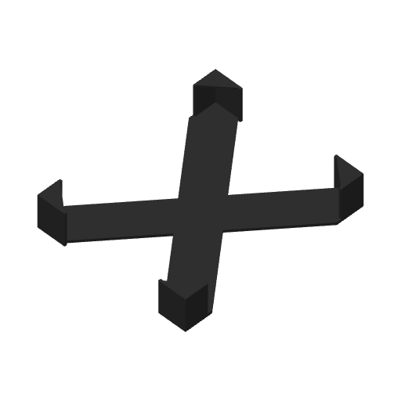

# Entropia XFrame v1

An X-shaped frame for [SeedPills](https://github.com/SeedSigner/SeedPills). Its four corner clips grip a block of printed SeedPills and hold the pills in place, so the set stays together during shipping and can stand on a desk as a display piece.

It comes in two versions:

- **Three-colour** (black, white and SeedSigner orange): "Don't trust / Verify" in the centre and "Entropia by SeedSigner" on two arms on the front, WWW.SEEDSIGNER.COM on the back. Needs a multi-colour printer.
- **Plain black**: the same frame as one solid part in one filament, with no lettering. For printers without a multi-colour system.

Size: 154.35 x 128.35 x 28.2 mm

| Front | Back | Plain black |
|---|---|---|
|  |  |  |

## Three-colour version

### What you need

- A printer that can print several colours in the same layer: a Bambu Lab AMS / AMS Lite, a Prusa MMU or similar. The colours sit side by side in the first 0.5 mm of the front and the last 0.5 mm of the back, so pausing to swap filament by hand won't work. Without one, use the plain black version.
- PLA in black, white and orange (SeedSigner orange, #FF7300).
- About 45 g of filament: roughly 40 g black, 3.3 g white and 1.9 g orange, including purging and the prime tower.
- About 2 hours of printing on a Bambu Lab A2L with the included settings.

### Files

| File | What it is |
|---|---|
| `Entropia_Xframe_v1.3mf` | Ready-to-print project for Bambu Studio / OrcaSlicer. All three colour parts are aligned and assigned to filaments 1-3, with print settings included. |
| `Entropia_Xframe_v1_1_frame_black.stl` | Filament 1, black #000000 |
| `Entropia_Xframe_v1_2_white.stl` | Filament 2, white #FFFFFF |
| `Entropia_Xframe_v1_3_seedsigner_orange_FF7300.stl` | Filament 3, orange #FF7300 |
| `Entropia_Xframe_v1_preview_front.png` | The finished front (the side that prints against the plate) |
| `Entropia_Xframe_v1_preview_back.png` | The back, with the white WWW.SEEDSIGNER.COM |

The STLs are the same parts as in the 3MF, for any other slicer. They share one coordinate system, so they line up when loaded together.

### How to print

- Print it as it loads: the front goes down on the plate, so the plate surface becomes the finish of the logo side. The included profile uses a textured PEI plate.
- The coloured inlays are 0.5 mm deep. The included 0.2 mm first layer and 0.16 mm layers give them three layers each; don't use layers thicker than 0.2 mm.
- The white URL is set 0.5 mm into the back, so the printer switches to white again for the last few layers.
- Settings in the 3MF: 0.4 mm nozzle, 0.16 mm layers (0.2 mm first layer), 3 walls, 100 % infill, prime tower on, supports off. The profile is made for a Bambu Lab A2L; in Bambu Studio / OrcaSlicer just switch to your own printer.
- Infill pattern: the project uses gyroid at 100 %. At 100 % every layer is solid, so the pattern makes no difference to the part. If your slicer refuses gyroid at 100 % (Bambu Studio's command-line slicer does), set the sparse infill pattern to rectilinear.

### Using the STLs in other slicers

- Load all three STLs at the same time. When the slicer asks whether to load them as a single object with multiple parts, say yes. In Cura, select all three and use Merge Models.
- Assign each part to its colour, and don't move the parts individually.
- Use the settings above: 100 % infill, no supports, front side down.
- Some slicers report a few auto-repaired / non-manifold edges. Those are spots where two letters touch at a single corner. They're harmless.

## Plain black version

The same frame with the same size and clips, as one solid part in one filament. It has no lettering or logos.

| File | What it is |
|---|---|
| `Entropia_Xframe_v1_plain_black.3mf` | Ready-to-print project for Bambu Studio / OrcaSlicer, one filament, same print settings as above |
| `Entropia_Xframe_v1_plain_black.stl` | The same part for any other slicer |
| `Entropia_Xframe_v1_plain_black_preview.png` | 3D view of the plain frame |

- Material: about 40 g of PLA in black (or any colour you like).
- About 1 hour 20 minutes of printing on a Bambu Lab A2L with the included settings.
- Print it as it loads, flat side down, with 100 % infill and no supports. The same infill note applies: switch gyroid to rectilinear if your slicer refuses gyroid at 100 %.

## Credits

Design: ENOGTYVE ([enogtyve.org](https://enogtyve.org))

SeedSigner name and logo belong to the SeedSigner project ([seedsigner.com](https://seedsigner.com)).

License: [CC BY 4.0](https://creativecommons.org/licenses/by/4.0/). You may use, modify, share and sell this design, as long as you credit ENOGTYVE. The license covers the frame design only; the SeedSigner name and logo are not covered by it.
